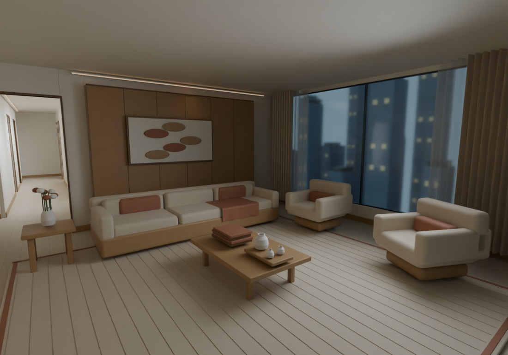
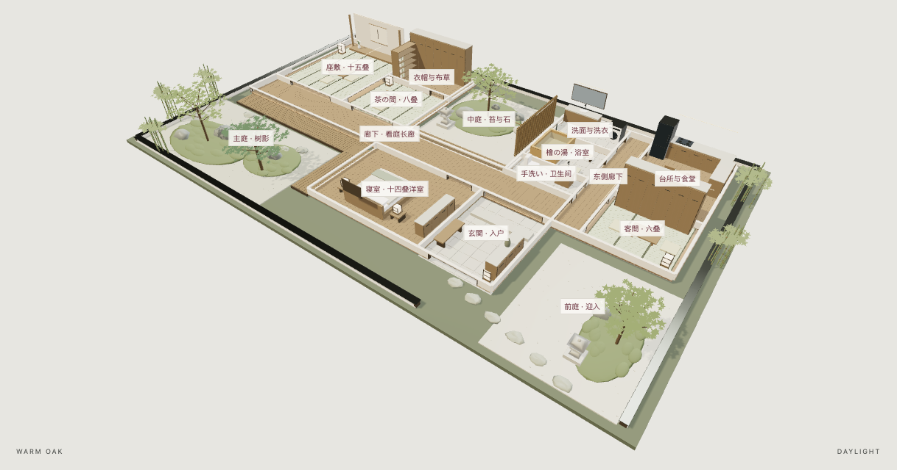
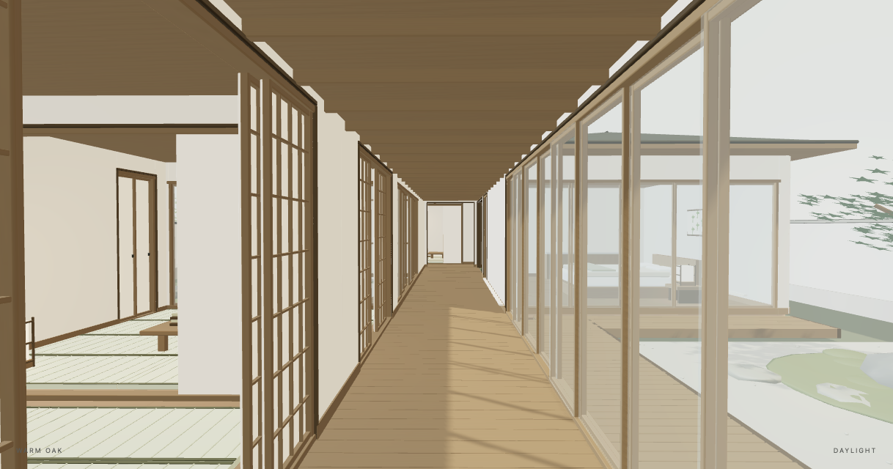
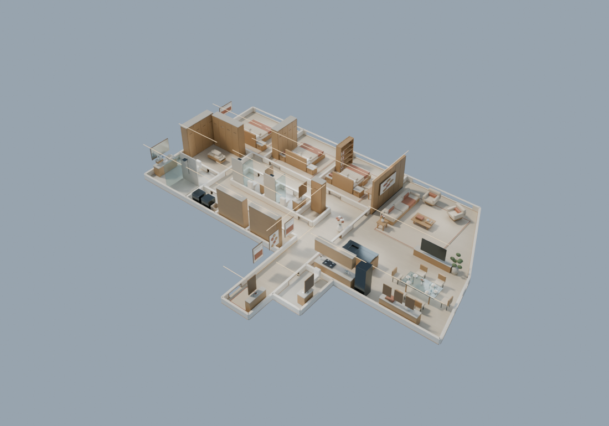
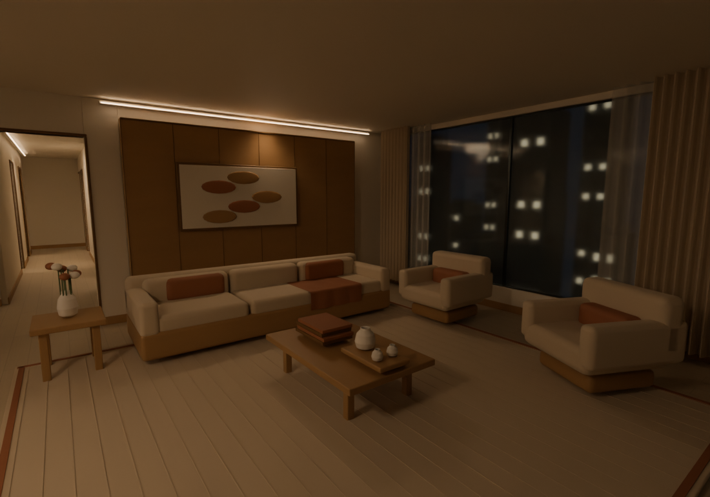
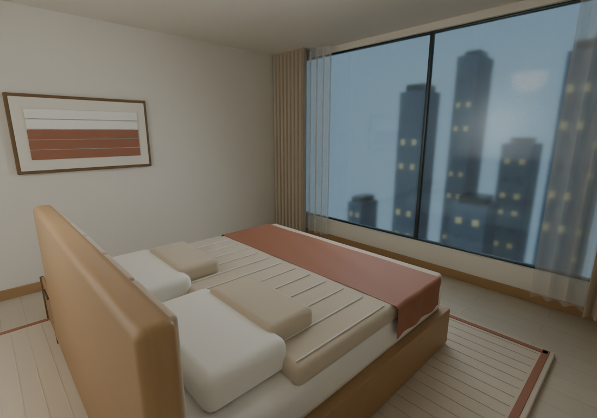

# Room as Code

**Keep a room as editable data. Change it in conversation. Preview continuously. Render when ready.**

Room as Code is a local residential 3D authoring prototype for Codex and Claude Code. A persistent scene file holds stable object IDs, dimensions, materials and edit history. Your agent turns a request into a revision-checked patch; local tools validate and save it, and the browser updates from the same file.

The public project is **Room as Code**. Its compatible skill, CLI helper and Claude plugin retain the name **`room-studio`**.



[Read the illustrated project guide](docs/Room_Studio_Project_Guide_EN.html) · [Download the PDF](docs/Room_Studio_Project_Guide_EN.pdf)

## Why a room as code?

- **Persistent scene data:** resume with the same scene, object identities and history.
- **Scoped edits:** widen an island, move a sofa or recolor a frame while preserving protected objects and existing overrides.
- **Atomic transactions:** patches check the current revision and return actual changed fields. Undo and redo survive a restart.
- **Visual iteration:** the bundled WebGL preview follows saved changes. Warm, Industrial Metal and Heritage themes, day/night and outdoor environment are independent controls.
- **Rendering as a separate step:** export editable Blender and GLB files; request a full PNG render after editing. Render provenance detects stale images.

This is an **early 0.1.0 prototype**, with two furnished residential samples—Manhattan and a Japanese three-garden house—plus a smaller component-grid fixture. Photos can inform an agent-authored scene; there is no automatic photo reconstruction algorithm.

## Quick start

Use Python 3.10+ and a browser with WebGL2. No Python packages or npm install are needed for the bundled preview. Blender 4.2+ is required for native export and rendering.

```sh
git clone https://github.com/leiyang2003/room-as-code.git
cd room-as-code
python3 skills/room-studio/scripts/room.py init my-house.scene.json
python3 skills/room-studio/scripts/room.py serve my-house.scene.json --port 8765
```

Open the loopback URL printed by the server. `init` creates the bundled apartment, not a reconstruction of your home. Stop the server with Ctrl+C. For another home, let the host agent author or adapt its data using your photos, dimensions and requirements. See [photo authoring](skills/room-studio/references/photo-authoring.md).

## Browse both residential samples

```sh
python3 preview_samples.py --port 8765
```

Open the printed loopback URL. The **住宅样例 / SAMPLE** selector switches between **Manhattan** and **三庭 · 静居 / NIWA TO MA**. Each launch creates a new `runs/` directory with editable copies; original examples stay intact. Edits, undo/redo and reloads belong to the selected sample. Share a local `?sample=manhattan` or `?sample=japanese` URL to choose the initial view. Stop the server with Ctrl+C.

The Japanese sample preserves **three open-to-sky gardens and an engawa corridor**. It contains 12 indoor spaces, 3 gardens, 241 editable entities and 3,049 compiled parts (3,033 mesh parts and 16 lights). Its 221.51 m² indoor design area is based on the reference listing; room dimensions, roofs and furnishings are authored estimates. Tatami, shoji/fusuma, low furniture, a hinoki bath, planting and roofs remain parametric. The opening slider controls real screen geometry; garden buttons jump to the three saved views.





These Japanese images are **interactive browser captures**, while the Manhattan images are native Blender renders. The Japanese scene also supports native export:

```sh
python3 skills/room-studio/scripts/room.py blender examples/japanese-three-gardens.scene.json --out output/three-gardens.blend --room engawa
```

For an existing registry, use `room.py serve <scene> --samples <registry.json> --port 8765`. Registry paths resolve relative to its JSON file and are an explicit local allowlist; the browser accepts sample IDs, never filesystem paths. Directly serving a registry edits the referenced files, so use `preview_samples.py` for fresh working copies.

## Install the conversational skill

From this checkout, install into your working project:

```sh
python3 install_skill.py --host codex --project /path/to/your-project
python3 install_skill.py --host claude --project /path/to/your-project
```

Codex receives `.agents/skills/room-studio/`; Claude Code receives `.claude/skills/room-studio/`. Existing installations are preserved, and `--link` is available for development. Keep your scene outside the installed skill directory.

Invoke `$room-studio` in Codex or `/room-studio` in Claude Code. For example:

> Inspect my-house.scene.json. Move the living-room sofa 30 cm along world +X and rotate it another 15 degrees. Keep its fabric override and every other object unchanged. Save the edit and check the result.

> Make the kitchen island 20 cm wider, keep the sink centered, and protect the dining table.

The model runs in the host agent. The viewer has no independent chat model or model API. Host access, authentication and any model charges are separate from this repository. Resolve ambiguous directions against the actual scene before editing.

Alternatively load this checkout as a local Claude plugin with `claude --plugin-dir /absolute/path/to/room-as-code`. The plugin namespace shown by the host may differ from a directly installed skill.

## Inspect, undo and export

```sh
python3 skills/room-studio/scripts/room.py inspect my-house.scene.json
python3 skills/room-studio/scripts/room.py undo my-house.scene.json
python3 skills/room-studio/scripts/room.py redo my-house.scene.json

# Check Blender discovery; set BLENDER to its executable if needed.
python3 skills/room-studio/scripts/room.py doctor

# Export without rendering: produces .blend, .glb and validation JSON.
python3 skills/room-studio/scripts/room.py blender my-house.scene.json --out output/house.blend

# Explicit final render: also synchronizes the native export.
python3 skills/room-studio/scripts/room.py render my-house.scene.json --out output/house.blend --image output/living.png --room living
python3 skills/room-studio/scripts/room.py render-status my-house.scene.json output/living.png
```

Blender is discovered locally and is not installed automatically. `doctor` checks native capabilities and reports an error when Blender is absent; editing and browser preview can still run without it.

Rendering uses PNG. The `.render.json` sidecar binds the image to scene content and renderer version. Status is `CURRENT`, `STALE` or `MISSING`; a later edit can make a saved image stale. Undoing to identical content can make it current again at a newer revision.

For exact patch operations, see [operations.md](skills/room-studio/references/operations.md). Native procedural wood, floor, fabric, stone, brushed steel, blackened steel and concrete materials remain editable in Blender. **GLB uses constant PBR colors and scalar properties; procedural textures are not baked.** See [native material behavior](skills/room-studio/references/native-materials.md).

## Industrial Metal theme

The previous Monochrome preset is now **Industrial Metal**: brushed-steel cabinetry, blackened-steel frames, concrete surfaces and graphite fabrics. This changes physical material recipes as well as colors. Layout, explicit color overrides, curtains and lighting settings are preserved. Older saved `mono` values remain compatible; new edits use `industrial`.

Choose **工业金属** in the preview or ask your agent to apply the `industrial` style. A fresh industrial example is available as `examples/manhattan-industrial.scene.json`. [See the live-preview capture](docs/images/industrial-metal-preview.jpg).

Material recipe version 3 also covers the native Blender surfaces and GLB PBR fallback. This update does not automatically render images. The illustrated guide and warm-theme renders remain useful examples; v0.1.0 release downloads preserve their original baseline.

## Example and scope



The apartment demonstration has 19 modeled spaces, 251 entities and 2,189 native meshes. Its approximate 267 m² design envelope and circulation are a parametric adaptation informed by a published Manhattan apartment plan. Furniture, finishes, heights and other missing dimensions are authored design assumptions. Source and rights are identified in [third-party notices](THIRD_PARTY_NOTICES.md); the reference PDF and private photos are excluded.





Current limits:

- Arbitrary homes need agent-authored data and generator work; the demo is not a general reconstruction benchmark.
- Patches edit existing entities, parameters, transforms, colors, visibility, themes, period and environment. New furniture families or complex geometry require code changes.
- Props are independently positioned; moving supporting furniture requires checking them.
- Curtains and throws are parametric geometry, not physical cloth simulation. Browser lighting and reflections approximate the native result.
- Detected external edits to managed Blender geometry/materials stop synchronization. Arbitrary hand edits are not automatically merged.
- This is a design prototype, not a surveyed, construction, manufacturing or photorealistic production model.

## Development and validation

```sh
python3 -m unittest discover -s tests -v
npm ci
npm run build
npx playwright install chromium
npm run test:browser
node tests/samples-browser.mjs
python3 build_release.py
```

Regenerate the illustrated guide with `uv run --with weasyprint --with markdown --with pypdf python docs/tools/build_project_guide.py` (WeasyPrint also needs its platform libraries).

Node and npm are needed only to rebuild the frontend or run browser tests. Set `CHROME_PATH` to reuse an installed Chrome executable instead of Playwright Chromium. Browser checks write QA artifacts to ignored `docs/qa/`.

Optional checks require Blender or configured host CLIs:

```sh
blender --background --factory-startup --python-exit-code 1 --python tests/final_native.py
python3 tests/host_edits.py --host codex --output docs/qa/codex-edits.json
python3 tests/host_edits.py --host claude --output docs/qa/claude-edits.json
```

Live host checks invoke your configured agent and can use paid model access. Their `.local.log` files remain private and are ignored. Host checks, browser checks, unit tests and Blender integration checks establish different things. See [validation evidence](docs/VALIDATION.md) for recorded results and scope.

## License

Original code and documentation are MIT licensed. Three.js is bundled with its MIT notice; Blender is a separately installed dependency. See [LICENSE](LICENSE) and [THIRD_PARTY_NOTICES.md](THIRD_PARTY_NOTICES.md).
