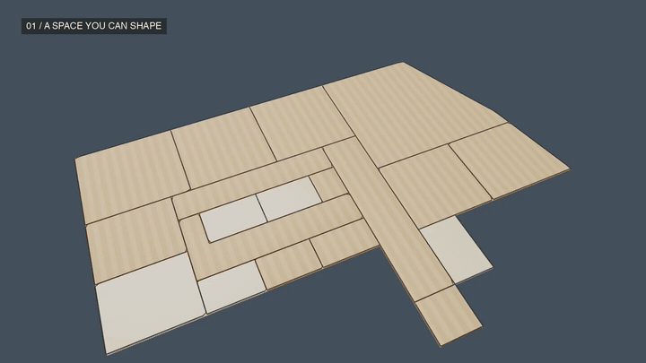
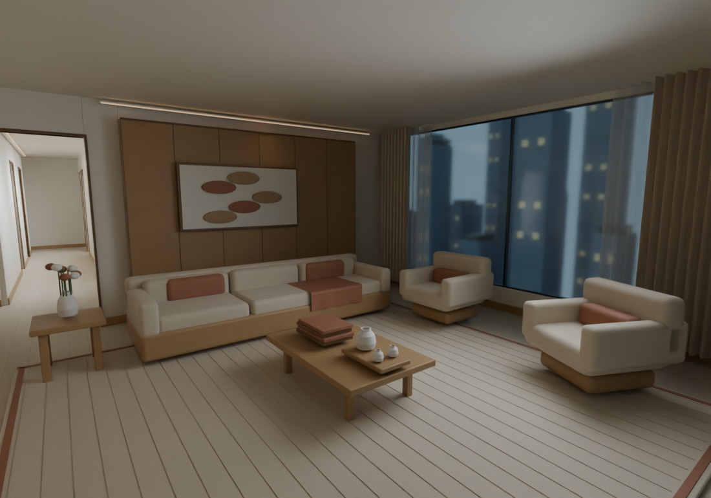
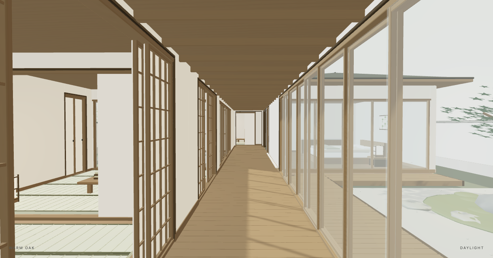

<p align="center"><a href="README.md">English</a> · <b>中文</b></p>

<h1 align="center">Room as Code</h1>

<p align="center"><b>用语音修改空间，留下可编辑的模型。</b><br>在对话中塑造三维住宅，在本机预览，接着上一次继续修改。</p>

<p align="center"><a href="docs/media/room-as-code.mp4">▶ 看 65 秒完整影片</a> · <a href="#开始使用">开始使用</a> · <a href="docs/PROJECT_DETAILS.md">技术说明</a></p>

[](docs/media/room-as-code.mp4)

<p align="center"><sub>Codex 与 Claude Code · 本地预览 · 可编辑 Blender + GLB · MIT</sub></p>

## 说出来，看它变化

“把岛台加长四十厘米，向内移动三十厘米。台面变深，餐桌和墙柜保持原位。”

然后接着改：

“保留这个位置，再缩短十厘米。台面变浅，底座改成炭黑色。”

Room as Code 把空间保存为**可编辑的场景数据**：物件 ID、尺寸、材质覆盖和修改历史持续保留。助手把请求转换为带版本检查的补丁，浏览器读取同一份场景。下一次修改接着上一次继续。

可以输入文字，也可以使用**宿主助手支持的语音输入**。本地预览器没有独立聊天模型、模型 API 或内置语音识别。

**[观看或下载完整影片 →](docs/media/room-as-code.mp4)** 影片结合实际模型编辑、原生渲染、照片参考及已标注的 AI 可视化。示例语音通过助手执行，部分模型细节为定制场景制作。[影片来源与格式说明](docs/media/README.md)。

## 从两个家开始

| 曼哈顿公寓 | 日式三庭住宅 |
|---|---|
|  |  |
| 十九个建模空间，开放厨房、客厅、三间卧室与配套房间。 | 三座露天庭院、榻榻米房间、可开合隔扇和缘侧廊道。 |

两套都是可继续编辑的完整家具样例，依据参考布局做设计改编；尺寸是创作假设，不是测绘结果。其他住宅可以和助手一起依据照片、尺寸与需求创作。**本项目不提供自动照片重建算法。**

## 改过之后，还能留下什么

| 你的需求 | 保存下来的结果 |
|---|---|
| 明天继续做 | 持久化场景和稳定物件身份 |
| 只改一个地方 | 限定作用范围、保护其他物件的补丁 |
| 撤回刚才的决定 | 跨重启保留的修改历史、撤销和重做 |
| 试试另一种氛围 | 独立的风格、昼夜与室外环境设置 |
| 把模型带到别处 | 可编辑的 `.blend` 与 `.glb` 导出 |

程序化材质在 Blender 中持续可编辑。GLB 保留恒定 PBR 颜色与参数，不烘焙程序化纹理。浏览器的照明和反射近似原生效果。

## 开始使用

Python 3.10+ 和支持 WebGL2 的浏览器即可运行预览。探索样例无需模型密钥，也不需要安装 Python 包或 npm 依赖。

```sh
git clone https://github.com/leiyang2003/room-as-code.git
cd room-as-code
python3 preview_samples.py --port 8765
```

打开服务打印的本地地址，在样例选择器中切换曼哈顿与日式三庭住宅。每次启动会在 `runs/` 创建新的工作副本，原始样例保留。用 Ctrl+C 停止服务。

### 带上你的助手

把对话式创作技能安装到工作项目：

```sh
python3 install_skill.py --host codex --project /path/to/your-project
python3 install_skill.py --host claude --project /path/to/your-project
```

在 Codex 调用 `$room-studio`，或在 Claude Code 调用 `/room-studio`。语言理解、可用的语音输入、认证及模型访问由宿主助手提供。技能、命令行工具和 Claude 插件保留兼容名称 **`room-studio`**。

> 检查 my-house.scene.json。把厨房岛台加宽二十厘米，餐桌和其他物件保持不变。保存修改并核对结果。

创建单独的工作场景：

```sh
python3 skills/room-studio/scripts/room.py init my-house.scene.json
python3 skills/room-studio/scripts/room.py serve my-house.scene.json --port 8765
```

`init` 创建自带公寓。其他住宅请参考[照片创作流程](skills/room-studio/references/photo-authoring.md)。

### 准备好，再导出

原生导出和渲染需要 Blender 4.2+。工具会发现本机已有安装，不会自动下载安装。

```sh
python3 skills/room-studio/scripts/room.py doctor
python3 skills/room-studio/scripts/room.py blender my-house.scene.json --out output/house.blend
```

完整图片渲染是独立步骤，渲染来源记录可识别旧图是否失效。[检查、撤销、渲染与开发说明](docs/PROJECT_DETAILS.md) · [原生材质说明](skills/room-studio/references/native-materials.md)。

## 继续了解

- [项目与影片页面](docs/index.html)：含完整影片、样例、昼夜对比和启动命令。在仓库根目录运行 `python3 -m http.server 8000`，打开 `http://localhost:8000/docs/` 即可查看。
- [图文项目指南](docs/Room_Studio_Project_Guide_EN.html) · [PDF 版本](docs/Room_Studio_Project_Guide_EN.pdf)。
- [完整技术说明](docs/PROJECT_DETAILS.md) · [补丁操作](skills/room-studio/references/operations.md) · [验证记录](docs/VALIDATION.md)。

## 当前边界与许可

这是 **0.1.0 早期住宅设计原型**。已有物件可调整尺寸、位置、风格，支持撤销与重做；新家具类型或复杂定制几何仍需编写生成器。道具独立摆放，移动承托家具后需要核查。任意外部 Blender 修改会被检测，不会静默合并。

它不是测绘 BIM、制造或施工模型。原创代码和文档采用 [MIT 许可](LICENSE)；图片来源、参考权益和打包依赖见[第三方说明](THIRD_PARTY_NOTICES.md)。影片采用[独立的素材说明](docs/media/README.md)。
